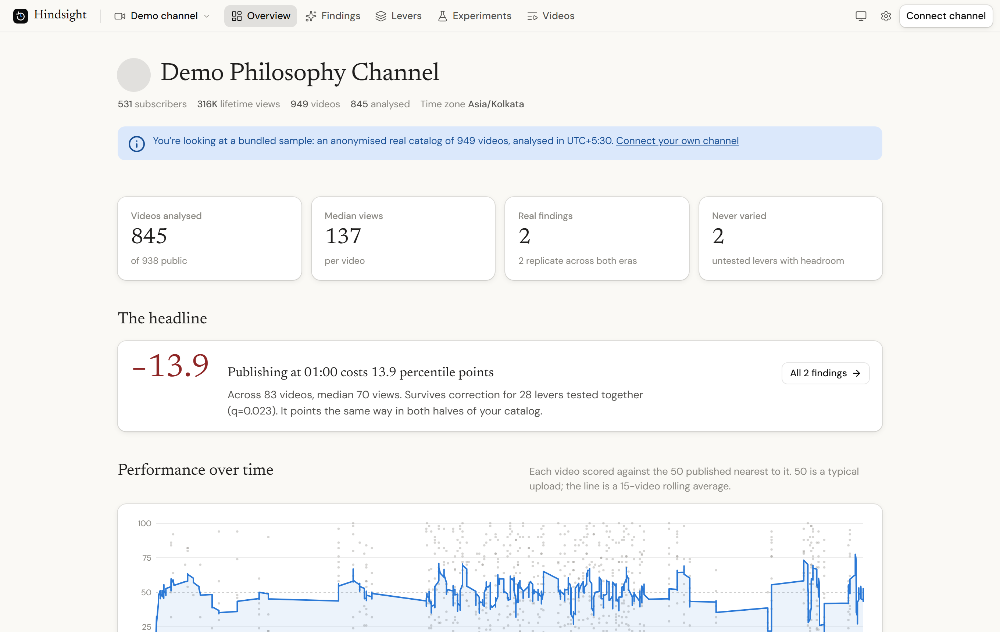
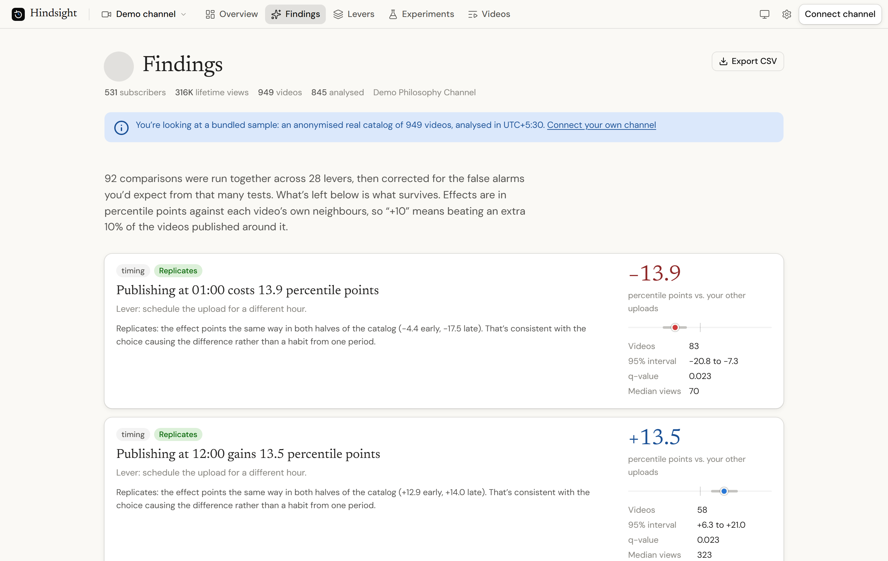
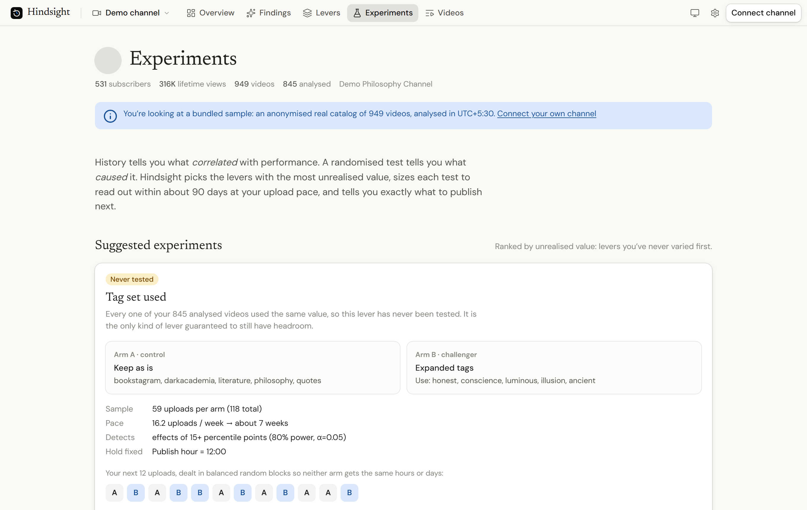
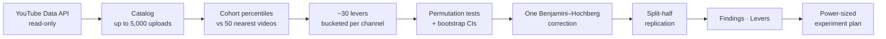

<div align="center">

# Hindsight

**Find out which of your YouTube upload choices actually moved your numbers, and what to test next.**

Hindsight reads your channel's back catalog, tests about 30 choices you make on every upload (posting hour, weekday, length, title style, tags), keeps only the results that survive proper statistics, and designs an A/B experiment for your next uploads.

[](https://github.com/harsh040506/hindsight-youtube-catalog-analytics/actions/workflows/ci.yml)
[](LICENSE)


[**Live demo (no sign-in)**](https://hindsight-youtube-catalog-analytics.vercel.app/dashboard/demo) · [Deploy your own](#deploy-your-own) · [How it works](#how-it-works) · [Self-hosting guide](docs/self-hosting.md)

<picture>
  <source media="(prefers-color-scheme: dark)" srcset="docs/images/overview-dark.png">
  
</picture>

</div>

## Why

Your channel has already run hundreds of experiments: every upload was a choice of title, length and posting time. Most analytics dashboards just rank your best videos, and that misleads you:

- **Raw views mostly measure age and channel size.** A video from last year had a smaller audience and more time to collect views.
- **With 30 things compared at once, some will look like winners by luck.** A "best hour" chart will always show a top bar, even when the hour makes no difference.
- **"No difference" can mean three things:** measured and null, never tried, or tried too rarely to measure. Dashboards treat them the same.

Hindsight handles all three, and tells you plainly when there's no finding.

**On the bundled sample channel** (949 short-form videos over 13 months), it found that publishing at 01:00 cost about 14 percentile points and publishing at 12:00 gained about 13.5. That's a 4.6× gap in median views from posting time alone. Both results survive correction for multiple testing and hold up in both halves of the catalog. It also found that every one of the 845 analysed videos used the same five tags, a lever that had never once been varied.

## Who it's for

- **YouTube creators and Shorts channels** with 100 or more public uploads who want evidence rather than guesswork about posting time, length and titles.
- **Channel managers and agencies** running several channels. You can connect up to six channels per browser, including brand accounts.
- **Analysts and data people** who want an honest method for messy creator data: cohort percentiles, permutation tests, false-discovery control and power-sized experiments.
- **Developers** looking for a working example of Next.js App Router with Google OAuth (PKCE) and no database.

## Features

| | |
|---|---|
| **Fair scoring** | Each video is ranked against the 50 videos published nearest to it, so channel growth, season and age cancel out. |
| **About 30 levers** | Length, description, tags, call-to-action, title length, emoji, opening word, "you" vs impersonal, question vs statement, frequent keywords, and publish hour, weekday and time of day in your time zone. |
| **Findings that hold up** | A permutation test and bootstrap 95% interval for every comparison, one Benjamini–Hochberg correction across all of them, and a re-check on the older and newer halves of the catalog. |
| **Untested levers** | Separates "tested", "never varied" and "too lopsided to measure". The levers you've never varied are often the most useful output. |
| **Experiment designer** | Suggests what to test, sizes it to read out within about 90 days at your upload pace, gives a balanced A/B upload schedule, and tracks the result without letting you stop early. |
| **Choose your metric** | Views, like rate, comment rate, or both combined. |
| **CSV export** | Videos, findings and levers, safe to open in any spreadsheet. |
| **Private by design** | Read-only YouTube access, no database, tokens encrypted in your own browser. |

<table>
  <tr>
    <td width="50%">
      <picture>
        <source media="(prefers-color-scheme: dark)" srcset="docs/images/findings-dark.png">
        
      </picture>
      <p align="center"><b>Findings</b>: only what survives correction</p>
    </td>
    <td width="50%">
      <picture>
        <source media="(prefers-color-scheme: dark)" srcset="docs/images/experiments-dark.png">
        
      </picture>
      <p align="center"><b>Experiments</b>: sized, scheduled, tracked</p>
    </td>
  </tr>
</table>

## Try it

- **Sample channel:** open the [live demo](https://hindsight-youtube-catalog-analytics.vercel.app/dashboard/demo). No account needed.
- **Your own channel:** press **Connect with Google** on the [home page](https://hindsight-youtube-catalog-analytics.vercel.app) and pick the account or brand channel. Your time zone is detected automatically.
- **Your own copy:** deploy it yourself in about 10 minutes (below). It's free on Vercel's Hobby plan and needs no database.

## Deploy your own

[](https://vercel.com/new/clone?repository-url=https%3A%2F%2Fgithub.com%2Fharsh040506%2Fhindsight-youtube-catalog-analytics&project-name=hindsight&env=GOOGLE_CLIENT_ID,GOOGLE_CLIENT_SECRET,SESSION_SECRET&envDescription=Google%20OAuth%20client%20and%20a%20random%20session%20secret&envLink=https%3A%2F%2Fgithub.com%2Fharsh040506%2Fhindsight-youtube-catalog-analytics%2Fblob%2Fmain%2Fdocs%2Fself-hosting.md)

1. In [Google Cloud](https://console.cloud.google.com), enable **YouTube Data API v3** and create an **OAuth client ID** (Web application) with the redirect URI `https://<your-domain>/api/auth/callback`.
2. Deploy with the button above and set three environment variables:

   | Variable | Value |
   |---|---|
   | `GOOGLE_CLIENT_ID` | from the OAuth client |
   | `GOOGLE_CLIENT_SECRET` | from the OAuth client |
   | `SESSION_SECRET` | output of `openssl rand -base64 32` |

3. Open `https://<your-domain>/api/health` and check for `"signIn":"ready"`. The site's `/setup` page shows your exact redirect URI and which variables are missing.

The [self-hosting guide](docs/self-hosting.md) covers the consent screen, custom domains, opening sign-in to the public (Google verification), API quota and optional shared rate limits.

## How it works



| Step | Code | What it does |
|---|---|---|
| Scoring | [`cohort.ts`](src/lib/analytics/cohort.ts) | Percentile of each video against the 25 before and 25 after it. Excludes videos at the catalog's edges, videos younger than 14 days, and livestreams. |
| Levers | [`features.ts`](src/lib/analytics/features.ts) | Turns each upload into choices. Numeric ones use the exact values your channel uses, or quartiles. |
| Statistics | [`analyze.ts`](src/lib/analytics/analyze.ts), [`stats.ts`](src/lib/analytics/stats.ts) | Compares each choice with the rest (at least 20 videos per side), corrects all comparisons together at q ≤ 0.05, and re-tests each finding on both halves of the catalog. |
| Experiments | [`experiment.ts`](src/lib/analytics/experiment.ts) | Sample size for 80% power, balanced random A/B blocks, and a readout that warns against peeking. |

The analysis is deterministic (fixed random seed), so the same catalog always gives the same results.

## Privacy and security

- **Read-only:** asks only for `youtube.readonly`. It cannot upload, edit or delete anything.
- **No database:** each channel's Google refresh token is sealed with AES-256-GCM in its own `httpOnly` cookie. Video data is cached in server memory for about 20 minutes.
- **Revocable:** disconnecting a channel revokes the grant at Google.
- **Hardened:** OAuth with PKCE and signed state, an ownership check on every data request, per-IP rate limits, cross-site request refusal, strict CSP and security headers, formula-safe CSV, and logs that redact tokens and emails.

See the in-app [privacy policy](https://hindsight-youtube-catalog-analytics.vercel.app/privacy) and [SECURITY.md](SECURITY.md).

## Limitations

- The YouTube Data API exposes public counters only (views, likes, comments). Retention, impressions and click-through rate need the YouTube Analytics API, which isn't used yet.
- Findings are observational: they show what correlated with performance on your channel. The Experiments page is how you confirm cause.
- About 100 analysable videos are needed for reliable findings, and 60 to design an experiment.
- Reads the 5,000 most recent uploads per channel.

## Development

Requires Node.js 22 or newer.

```bash
npm install
cp .env.example .env.local      # fill in the three variables
npm run dev                     # http://localhost:3000
```

| Command | What it runs |
|---|---|
| `npm test` | Unit tests: statistics, security helpers, and a regression test on the sample catalog |
| `npm run typecheck` | TypeScript checks |
| `npm run build && npm run e2e` | Browser tests against a mock Google and YouTube server (run `npx playwright install chromium` once first) |

CI runs all of these on every push.

```
src/
  app/              pages, dashboard routes and API routes (auth, export, health)
  components/       UI: charts, menus, dialogs, tables
  lib/analytics/    the analysis engine (pure TypeScript, no framework code)
  lib/              OAuth, sessions, YouTube client, rate limits, caching
data/demo.json      anonymised 949-video sample catalog
e2e/                Playwright tests and the mock Google/YouTube server
tests/              unit tests (Vitest)
docs/               self-hosting guide and screenshots
```

## Contributing

Issues and pull requests are welcome. See [CONTRIBUTING.md](CONTRIBUTING.md). Ideas that would help most: YouTube Analytics API support (retention and CTR), more levers (thumbnails, chapters, Shorts vs long-form), and translations.

## License

[MIT](LICENSE). Hindsight uses YouTube API Services and isn't affiliated with or endorsed by YouTube or Google.
